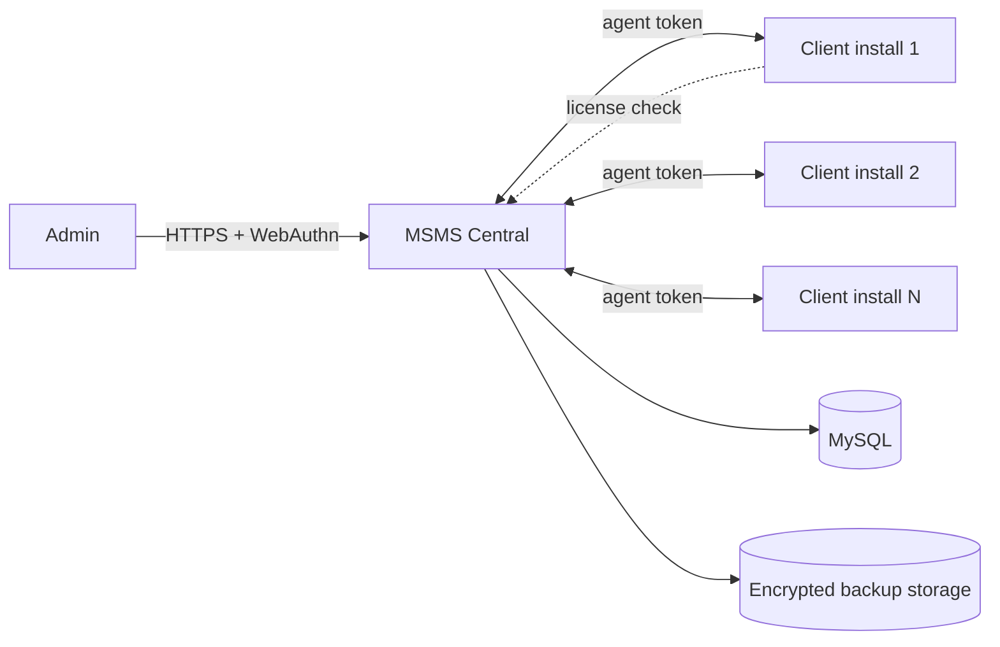

 

**One control panel for every MSMS client installation.**

> 🔒 **Source code is private.** This repository is a public showcase of the project. For demos or collaboration, contact [hello@imadhimthiyas.nl](mailto:hello@imadhimthiyas.nl).

---

## Overview

MSMS Central is a standalone portal that manages many client installs of [Ivenza POS](https://github.com/imadhimthiyaz/ivenza-pos-showcase) from a single place. Register a client by domain, sync its live status, control its license, push announcements and updates, top up SMS credit and pull encrypted database backups.

## Features

- 🏢 **Client registry**: register every installation by domain, with a detail page per client
- 🔄 **Live sync**: status, SMS balance, reload history, users, customers, products, pending repairs and database size, individually or all at once
- 🪪 **Licensing**: mark clients active, trial, suspended or expired, with a license API clients can enforce
- 📣 **Announcements**: publish messages (with images) to client installs
- ⬆️ **Updates**: package and track update rollouts, with client update reports
- 💬 **SMS credits**: manage SMS credit reloads per client
- 💾 **Backups**: trigger client-side database backups, stored encrypted and downloadable on demand
- 🚨 **Alerts & history**: sync and backup history with an alerts view
- 🔐 **Secure sign-in**: hashed admin password plus WebAuthn / biometric login
- 📲 **PWA**: installable, with offline screen and icons

## Architecture

